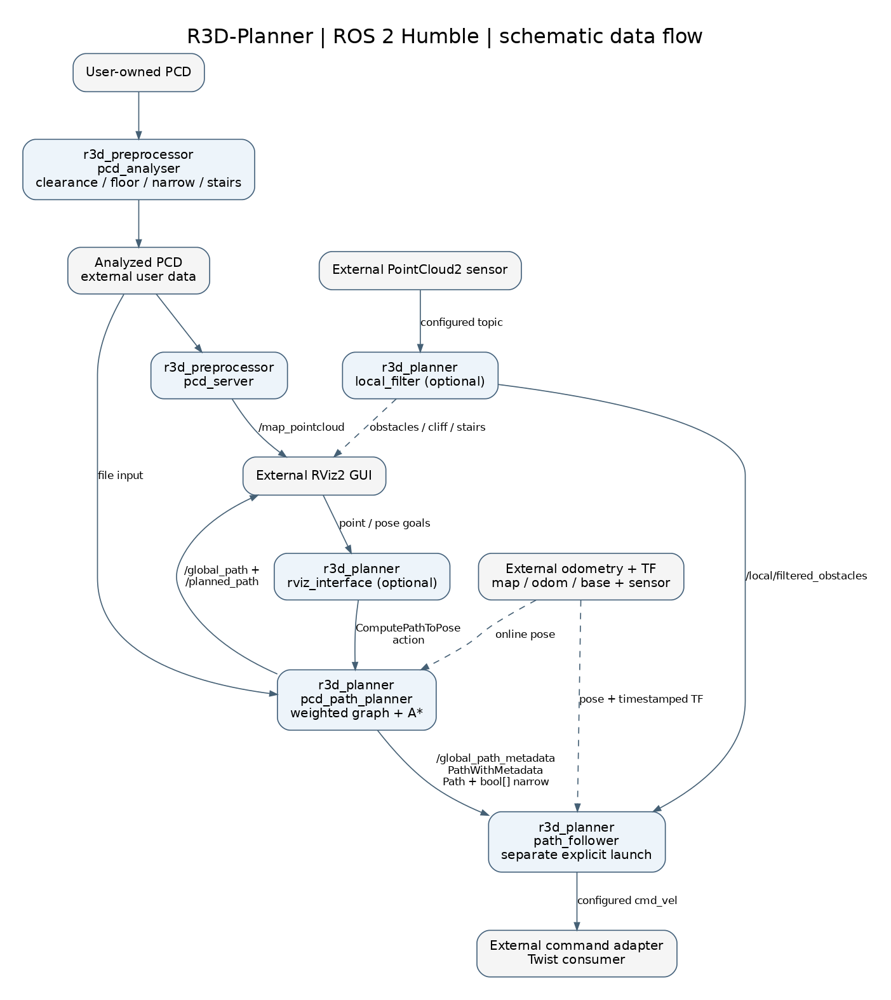

# R3D-Planner

R3D-Planner is a ROS 2 stack for planning paths through voxelized 3D point-cloud
maps. It classifies traversable space for a configured robot, reconstructs a
weighted graph and computes A* paths through the standard
`nav2_msgs/action/ComputePathToPose` action.

Supported environment: **ROS 2 Humble, Ubuntu 22.04 Jammy, Python 3.10, amd64**.

| Package | Purpose |
|---|---|
| `r3d_preprocessor` | Classify PCD maps by robot clearance and traversability |
| `r3d_planner` | Global planning, local point-cloud filtering, RViz input and path following |
| `r3d_interfaces` | `PathWithMetadata`: a geometric path with per-pose narrow-area flags |

## How it works



The preprocessor writes a classified PCD. The planner loads that file and serves
path requests. The local filter and RViz interface are optional. The follower
starts separately and consumes the path with its narrow-area flags.

Sensor drivers, odometry, global localization and the robot command interface
are external. The stack has no dependency on a particular SLAM implementation.

## Installation

Build all three packages in a ROS 2 workspace using the Humble system Python
environment. Follow [Installation and startup](docs/INSTALL.md) for clone,
rosdep and colcon commands.

No example maps are bundled. Provide your own PCD input and configure the paths
before starting a launch file.

## Configuration

The entry point is `r3d_planner/config/planner_config.yaml`. Its `robot_config`
field selects a profile such as `robots/Go2W.yaml`.

- The central file owns map paths, processing, graph settings and controller tuning.
- The robot profile owns dimensions, odometry frames/topic, sensor/command topics
  and velocity settings.
- For an installed workspace, copy the configuration to a user-owned directory
  and set `R3D_CONFIG_DIR`; see the [configuration reference](docs/CONFIGURATION.md).
- YAML changes take effect after restarting the affected launch. Regenerate the
  analyzed map when robot geometry or processing settings change.

The Go2W profile contains:

```yaml
robot:
  velocity_limits:
    max_linear_speed: 0.35       # m/s
    max_angular_speed: 0.6       # rad/s
    max_angular_speed_narrow: 0.2 # rad/s
    narrow_speed_factor: 0.4
```

This is an excerpt, not a complete profile. Aligned narrow-area travel uses
`0.35 * 0.4 = 0.14 m/s`; rotation-only and stop commands can still be zero.
All four settings are required and expose read-only ROS parameters. Conflicting
startup overrides or invalid configuration abort startup.

## Prepare a map

Set `maps.pcd_path` to the input PCD and `preprocessing.output_dir` to the desired
output directory, then run:

```bash
ros2 launch r3d_planner preprocessor.launch.py
```

The one-shot analyzer writes `<input-name>_analysed.pcd`. Green means floor,
cyan narrow clearance, yellow stair access and magenta obstacles. Existing
output files are not overwritten. Set `maps.map_name` to the analyzed file.

To display that map:

```bash
ros2 launch r3d_planner map.launch.py
rviz2
```

In RViz use fixed frame `map`, PointCloud2 topic `/map_pointcloud`, Transient
Local durability and RGB8 coloring.

## Plan a path

```bash
ros2 launch r3d_planner planner.launch.py
```

This starts the planner and the components selected by
`components.live_filter.enabled` and `components.rviz_interface.enabled`.
It does not start RViz, hardware drivers or the follower.

For planning without hardware, disable both optional components and send an
explicit start and goal. Replace the example coordinates with positions in your
map and use the configured map frame:

```bash
ros2 action send_goal /compute_path_to_pose nav2_msgs/action/ComputePathToPose "{
  use_start: true,
  start: {
    header: {frame_id: 'map'},
    pose: {position: {x: 0.0, y: 0.0, z: 0.0}, orientation: {w: 1.0}}
  },
  goal: {
    header: {frame_id: 'map'},
    pose: {position: {x: 5.0, y: 0.0, z: 2.5}, orientation: {w: 1.0}}
  },
  planner_id: 'GridBased'
}"
```

The action returns a geometric `nav_msgs/Path`. The planner also publishes
`/global_path`, `/planned_path` and `/global_path_metadata`. The last message
contains the path and one narrow-area flag per pose.

For online planning, `use_start: false` requires fresh configured Odometry and
timestamped `map -> odom` TF. RViz goal selection and TF ownership are described
in [Architecture and ROS interfaces](docs/ARCHITECTURE.md).

## Path following

```bash
ros2 launch r3d_planner follower.launch.py
```

This separate launch publishes velocity commands. The follower uses XY/yaw,
not path height, and does not directly consume cliff or stair outputs. Obstacle
freshness/TF monitoring is optional and disabled by default. Configure it under
`path_follower.obstacle_monitoring` as described in the
[configuration reference](docs/CONFIGURATION.md#obstacle-monitoring).

Robot integration requires suitable sensor frames, odometry, command watchdogs
and independent stop facilities. See [Known limitations](docs/KNOWN_ISSUES.md)
before operating hardware.

## Documentation

- [Installation and startup](docs/INSTALL.md)
- [Configuration reference](docs/CONFIGURATION.md)
- [Architecture and ROS interfaces](docs/ARCHITECTURE.md)
- [Known limitations and troubleshooting](docs/KNOWN_ISSUES.md)

## License

R3D-Planner is distributed under [Apache-2.0](LICENSE). Source files retain
their applicable copyright and third-party notices.
