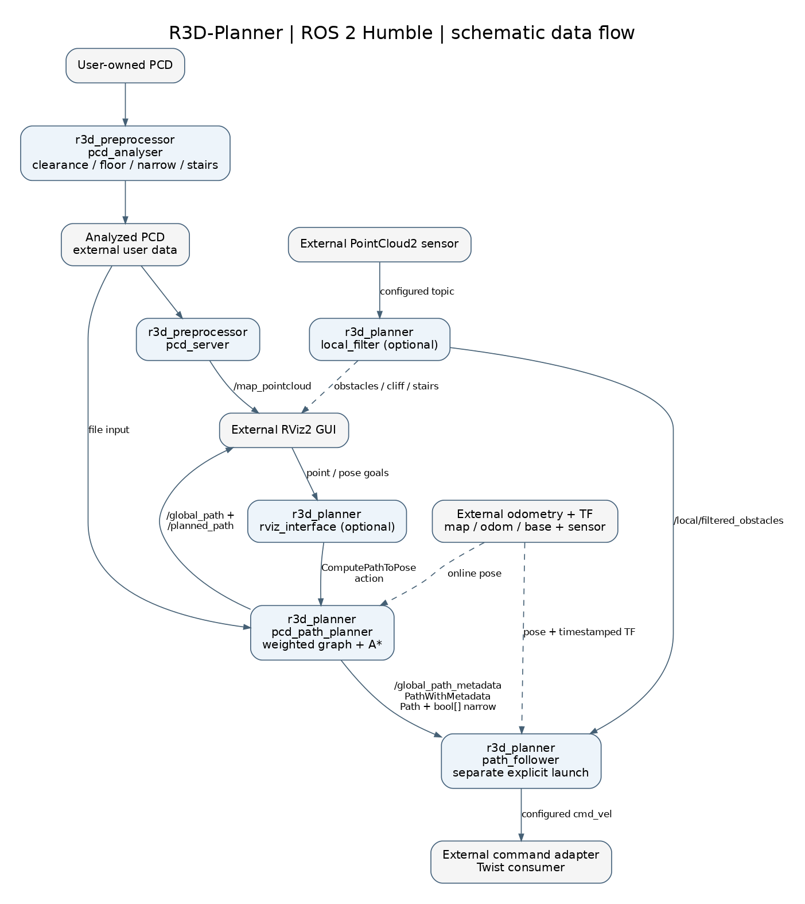

# Architecture and ROS interfaces

## System boundary

R3D-Planner separates offline map classification, global planning, local
point-cloud filtering, RViz input and path following into ROS 2 nodes.

The robot integration supplies the LiDAR driver, sensor calibration, standard
Odometry, global localization, hardware command adapter and independent command
supervision. No particular SLAM package or hardware SDK is launched here.



The diagram shows the default interfaces and optional components. Its
[Graphviz source](images/r3d_dataflow.dot) is included alongside the image.

## Packages and nodes

`r3d_planner` depends on `r3d_preprocessor` and `r3d_interfaces`. The preprocessor
and interface package are independent of each other. All four launch entry
points belong to `r3d_planner`.

| Package/executable | Node name | Purpose |
|---|---|---|
| `r3d_preprocessor/pcd_analyser` | `pcd_to_graph_node` | One-shot map analysis; writes `_analysed.pcd` |
| `r3d_preprocessor/pcd_server` | `pcd_publisher` | Publishes a classified PCD for visualization |
| `r3d_planner/pcd_path_planner` | `global_graph_planner` | Graph-based path action server |
| `r3d_planner/local_filter` | `obstacle_cliff_filter` | Local obstacle, stair and cliff outputs |
| `r3d_planner/rviz_interface` | `r3d_rviz_interface` | RViz selections, calibration TF and action requests |
| `r3d_planner/path_follower` | `r3d_path_follower` | Planar path following and velocity commands |
| `r3d_planner/path_test` | `r3d_path_test` | Static identity `odom -> base_link` test TF; no Odometry |

`r3d_pcd_voxel_publisher.py` is not registered as a console executable. Use
`pcd_server` through `map.launch.py` for map display.

## Launch and configuration

| Launch | Started subsystem |
|---|---|
| `preprocessor.launch.py` | One-shot PCD analyzer |
| `map.launch.py` | Classified PCD publisher |
| `planner.launch.py` | Planner and independently optional local filter/RViz interface |
| `follower.launch.py` | Separate motion-producing follower |

The central `planner_config.yaml` selects `robots/Go2W.yaml` or another relative
profile. Robot geometry, topics, frames and velocity settings have one owner in
that profile. General settings stay in the central YAML. Shared voxel/step
settings are forwarded to map analysis and graph reconstruction.

The loader validates YAML at startup. `R3D_CONFIG_DIR` selects a user-owned
configuration directory; source/symlink and installed package-share lookup are
also supported. Changes require launch restart. See
[CONFIGURATION.md](CONFIGURATION.md) for all fields and units.

## Offline map processing

1. Load a user-provided PCD with Open3D.
2. Optionally supplement floor samples using XY density cells.
3. Voxelize and discard weakly observed voxels.
4. Apply cylindrical clearance checks using the robot's radius, height and base clearance.
5. Classify floor, narrow clearance, stair access and obstacles.
6. Optionally fill small gaps in near-planar surfaces.
7. Write `<input-name>_analysed.pcd` to the configured output directory.

Colors are green for floor, cyan for narrow clearance, yellow for stair access
and magenta for obstacles. Input coordinates are not transformed. The classified
PCD must already use the intended map coordinate system.

At startup, the planner reconstructs a NetworkX graph from point coordinates and
RGB classes, excluding magenta obstacles. Voxel size and step heights must match
the settings that generated the file. Changing robot geometry does not
reclassify an existing map.

## Path planning and metadata

`compute_path_to_pose` uses `nav2_msgs/action/ComputePathToPose`. For
`use_start: true`, start and goal must be valid poses in `planner.map_frame`.
For `use_start: false`, the planner transforms fresh standard Odometry into
the map frame at the pose timestamp. Other request frames are rejected.

Start and goal snap to nearest traversable graph nodes through a SciPy KDTree.
Weighted A* produces a geometric `nav_msgs/Path`; XY tangent orientations are
normalized. The action result includes that path and planning time. The planner
publishes the same path on `/global_path`, metadata on `/global_path_metadata`
and a LINE_STRIP visualization on `/planned_path`.

`r3d_interfaces/msg/PathWithMetadata` contains:

```text
nav_msgs/Path path
bool[] narrow
```

`narrow[i]` describes `path.poses[i]`. The complete path and exactly one flag per
pose travel atomically. Quaternion fields represent geometry, never flags.
Invalid metadata clears the follower path. Planner and follower must use the
same generated interface.

Invalid input, missing/stale online pose or TF, and empty/unreachable paths
abort a request. Cancellation is cooperative. An aborted or canceled request
does not revoke a previously published follower path. `planner_id` does not
select a plugin; Humble's feedback is empty. The server is not a complete Nav2
lifecycle/planner-plugin implementation.

## Local perception and path following

The local filter assumes sensor X forward, Y lateral and Z up. It does not
transform points into the robot base frame. Stair/cliff processing uses its XY
radial gate. With `retain_near_obstacles: true`, height-qualified near returns
are also retained in the obstacle output. PointCloud2 outputs preserve the
original frame and measurement stamp.

The follower receives the atomic path and flags, obtains the robot's XY/yaw
from Odometry/global TF and selects a lookahead waypoint. Its default control
period is 0.1 s and goal tolerance is 0.2 m. Velocity settings come exclusively
from the selected robot profile. Go2W uses normal limits of 0.35 m/s and
0.6 rad/s, with aligned narrow travel at 0.14 m/s and a narrow angular cap of
0.2 rad/s. Larger narrow-area heading errors produce rotation-only commands.

Obstacles are evaluated in the open rectangle
`obstacle_x_min < x < stop_distance`, `abs(y) < obstacle_half_width`.
With optional monitoring enabled, input time, layout, geometry and timestamped
sensor-to-base TF are validated before this test. Without monitoring, received
coordinates are evaluated directly. See
[Obstacle monitoring](CONFIGURATION.md#obstacle-monitoring).

The follower is planar: it ignores path Z and does not directly consume cliff
walls or stair detections. Missing path, invalid metadata, unavailable/stale
pose, detected obstacles or an enabled monitor without valid input produce
zero commands. Hardware watchdogs and stop facilities remain external.

## Topics

Names below are defaults without a namespace.

| Topic | Type | Publisher → consumer | QoS |
|---|---|---|---|
| `/lidar_odometry` | `nav_msgs/msg/Odometry` | external → planner/follower | SensorDataQoS |
| `/map_pointcloud` | `sensor_msgs/msg/PointCloud2` | map publisher → RViz/external | reliable, transient-local, depth 1 |
| `/planned_path` | `visualization_msgs/msg/Marker` | planner → RViz/external | reliable, depth 10 |
| `/global_path` | `nav_msgs/msg/Path` | planner → external | reliable, depth 10 |
| `/global_path_metadata` | `r3d_interfaces/msg/PathWithMetadata` | planner → follower | reliable, transient-local, depth 1 |
| `/hesai_ros_driver/hesai/lidar_points` | `sensor_msgs/msg/PointCloud2` | external → local filter | SensorDataQoS |
| `/local/filtered_obstacles` | `sensor_msgs/msg/PointCloud2` | local filter/external → follower | internal output reliable/depth 10; input SensorDataQoS |
| `/local/cliff_virtual_wall` | `sensor_msgs/msg/PointCloud2` | local filter → external | reliable, depth 10 |
| `/stair_detect` | `geometry_msgs/msg/PointStamped` | local filter → external | reliable, depth 10 |
| `/cmd_vel` | `geometry_msgs/msg/Twist` | follower → external base | reliable, depth 10 |
| `/clicked_point` | `geometry_msgs/msg/PointStamped` | RViz/external → RViz interface | reliable, depth 10 |
| `/initialpose` | `geometry_msgs/msg/PoseWithCovarianceStamped` | RViz/external → RViz interface | reliable, depth 10 |
| `/goal_pose` | `geometry_msgs/msg/PoseStamped` | RViz/external → RViz interface | reliable, depth 10 |

SensorDataQoS is best-effort, volatile, keep-last depth 5; subscriptions also
accept reliable producers. Odometry, cloud input and command topics are
robot-configurable. Optional obstacle monitoring can use another input topic.

## Services and actions

| Name | Type | Server |
|---|---|---|
| `/compute_path_to_pose` | `nav2_msgs/action/ComputePathToPose` | global planner |
| `/recalibrate_pose` | `std_srvs/srv/Trigger` | RViz interface |

ROS parameter services are additional standard node interfaces.

## RViz and TF ownership

The intended transform chain is:

```text
map -> odom -> base_link -> sensor frame
```

External odometry owns `odom -> base_link`; sensor extrinsics are external.
Global localization owns `map -> odom`, or the RViz interface can publish a
static calibration when `publish_map_odom: true`. Use exactly one owner.

RViz calibration pairs a 3D Publish Point with a nearby 2D Pose Estimate.
Goal selection pairs Publish Point with 2D Goal Pose. The point supplies Z;
the pose supplies orientation. Pairing uses the configured XY match radius.
Calibration assumes an identity odometric base pose. With an external global
localizer, set `publish_map_odom: false`; initial calibration is then unnecessary.
`/recalibrate_pose` resets selection state, not an already published static TF.

All four launches accept `namespace:=robot_a`. Internal planner, metadata,
marker, map, RViz, action and service names follow that namespace. Relative
robot topics do too; explicit absolute robot topics remain global. TF frame
IDs are not automatically prefixed. Direct executables support ordinary ROS
remapping. See [KNOWN_ISSUES.md](KNOWN_ISSUES.md) for integration boundaries.
